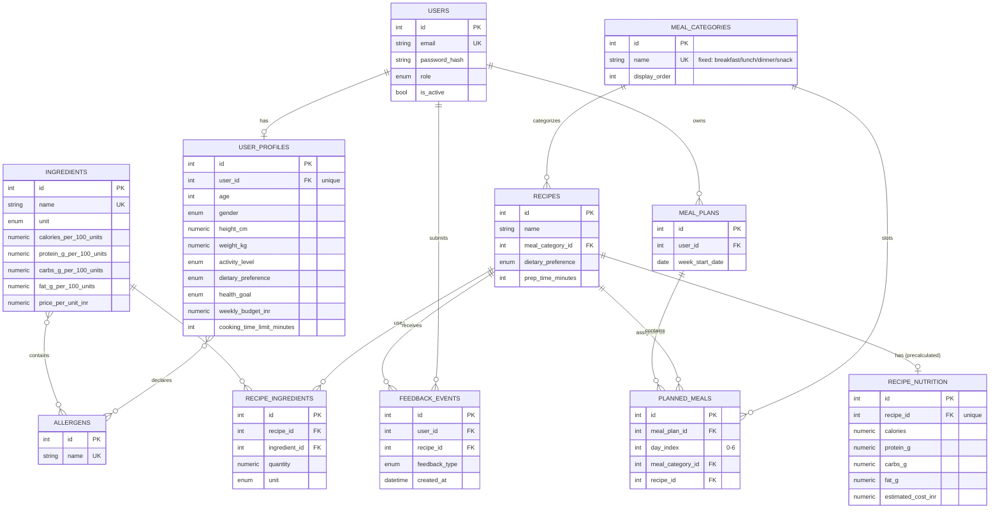

# Database Design

Entities implemented in `backend/app/models/` and created by the initial Alembic migration
(`backend/alembic/versions/224368fb6053_initial_schema.py`). All monetary values use exact
`NUMERIC` columns in INR (see `docs/requirements/open-decisions.md`, decision D9).

## Entity-relationship diagram

## Notes on specific design choices

- **Allergens are structural, not string-matched.** `Allergen` is its own table, joined to
  `Ingredient` via `ingredient_allergens` and to `UserProfile` via `user_profile_allergens`
  (both many-to-many). The rule engine's allergy filter (`rule_engine/filters.py`) can
  therefore match by `allergen_id`, not by parsing ingredient name strings.
- **Every recipe belongs to exactly one meal category** via a non-nullable
  `recipes.meal_category_id` foreign key — there is no way to represent a recipe with zero or
  multiple categories.
- **`MealCategory` is fixed at four seeded rows** (breakfast, lunch, dinner, snack), created by
  the initial migration, not by application code. See
  `docs/requirements/open-decisions.md`, decision D1, for why admin "CRUD" over this table is
  narrowed to read/update only.
- **`RecipeNutrition` and `Ingredient`'s per-100-unit nutrition are both pre-calculated and
  stored**, not computed on the fly, per the SRS assumption that recipe nutrition is
  available before meal generation. `RecipeNutrition.estimated_cost_inr` is similarly a
  precomputed total so the rule engine's per-meal budget check can read one row instead of
  summing `recipe_ingredients × ingredient price` on every request.
- **`PlannedMeal.day_index`** (0–6) is relative to `MealPlan.week_start_date`, an
  implementation choice (not specified verbatim in the SRS) made to avoid duplicating an
  absolute date per slot. A `(meal_plan_id, day_index, meal_category_id)` unique constraint
  guarantees one recipe per day/slot.
- **Feedback events are append-only facts** (`feedback_events`), not a mutable "current
  preference" row — REQ-4.4.2 requires a timestamped event per feedback action, and the
  weighted scoring (`app/models/enums.FEEDBACK_WEIGHTS`) is computed by summing these events,
  not by overwriting a single score column.
- **Illustrative data only.** No food price, nutrition, or recipe data has been seeded beyond
  the four structural `MealCategory` rows. Any future seed script for sample foods/recipes
  must be clearly labelled as illustrative development data, not verified production data
  (master prompt Section 6).

## Migration strategy

The schema is created by a hand-written-but-validated initial Alembic migration (not
`Base.metadata.create_all()` at app startup), so that schema evolution is tracked and
reviewable going forward. The migration was applied and rolled back against a real
PostgreSQL 16 instance during this milestone (see `backend/tests/test_db_integration.py`
for the automated check); see the Milestone 0 completion report for details.
