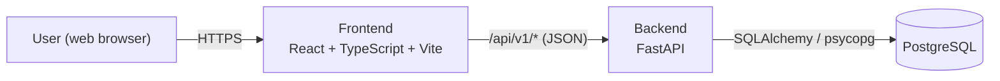
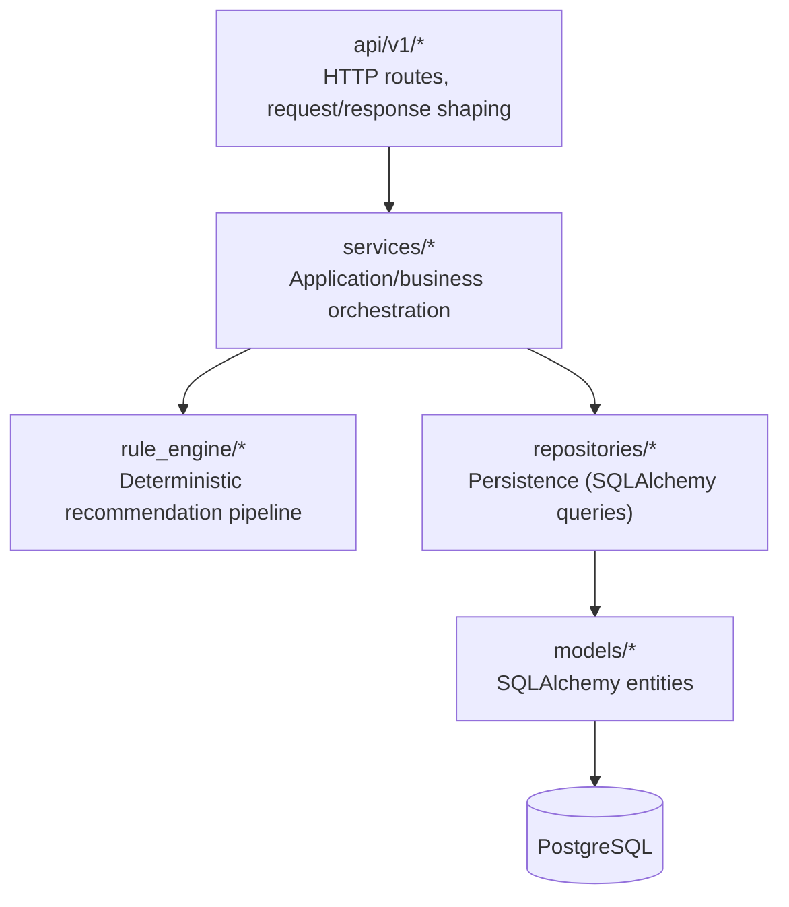
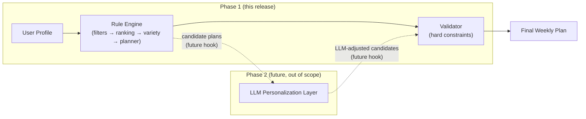

# Architecture Overview

This describes the Milestone 0 (Project Foundation) architecture and how it maps to the
SRS's Phase 1 / Phase 2 roadmap. See `docs/requirements/requirements-matrix.md` for the
requirement-by-requirement mapping and `docs/requirements/open-decisions.md` for the
assumptions behind several of the choices below.

## System context

This matches the SRS Section 2.1 perspective: *User (Web Client) → Application Server
(Rule Engine + Business Logic) → Databases → Response back to User*. In development, the
frontend talks to `/api` and Vite's dev server proxies those requests to the FastAPI
process on port 8000 (see `frontend/vite.config.ts`); no CORS round-trip is needed in dev,
though the backend also sets CORS headers for any case where the two are served from
different origins.

## Backend layering

- **api/** never talks to the database directly — it depends on **services/** (or, for
  Milestone 0's stub routes, returns HTTP 501 directly, since there is no business logic to
  orchestrate yet).
- **services/** orchestrates **repositories/** (data access) and **rule_engine/** (pure
  recommendation logic) on behalf of a route. No concrete services exist yet.
- **rule_engine/** is intentionally independent of SQLAlchemy and FastAPI — it operates on
  plain dataclasses (`rule_engine/types.py`) so every stage (nutrition, filters, ranking,
  variety, planner, validator) is unit-testable in isolation and reusable, unchanged, as the
  Phase 2 LLM layer's pre- and post-validation step (Project Description Section 11).
- **repositories/** isolate persistence from business logic, per SRS Section 5.4
  (Maintainability).
- **models/** is the single source of truth for the schema; Alembic migrations are derived
  from it (see `docs/architecture/database-design.md`).

## Frontend structure

- `app/` — router and top-level app shell.
- `components/ui/` — reusable primitives (Button, Card, Badge, PlannedFeatureNotice) with no
  feature-specific logic.
- `components/layout/` — shared navigation (`NavBar`), `Footer`, and the `AppLayout` that
  wraps every page via React Router's layout routes.
- `pages/` — one component per route (Landing, Login, Register, Profile, Meal Plan, Meal
  Details, Grocery List, Dashboard, Admin, Not Found).
- `features/` — feature-specific logic and components that don't belong in a generic
  primitive (currently: `features/health/HealthIndicator.tsx`, which calls the real backend
  health endpoint).
- `hooks/` — reusable hooks (`useHealthCheck`).
- `lib/` — shared infrastructure, currently the single Axios instance (`apiClient.ts`) every
  feature imports instead of constructing its own HTTP client.
- `types/` — TypeScript types mirroring backend Pydantic schemas.

Every page whose backend isn't implemented yet renders a `PlannedFeatureNotice` stating
which milestone will implement it, rather than fabricating data or a working-looking flow
(master prompt Section 8).

## Phase 1 → Phase 2 boundary

The validator is deliberately kept as its own module, independent of ranking/variety, so
that when Phase 2 is built, the *same* validator can run again after the LLM layer —
diet, allergy, and budget constraints are enforced identically regardless of whether a
candidate came from the rule engine or an LLM suggestion (Project Description Section 11).
No Phase 2 code, LLM API calls, or ML dependencies exist in this repository.

## Why the admin "CRUD categories" requirement is narrowed

See `docs/requirements/open-decisions.md`, decision D1: `MealCategory` is a seeded,
migration-managed table fixed at exactly four rows. This is a deliberate narrowing of
REQ-4.7.5 to preserve the SRS's "every recipe belongs to exactly one of four meal
categories" invariant, which several other requirements (REQ-4.2.1, Section 2.5) depend on.
